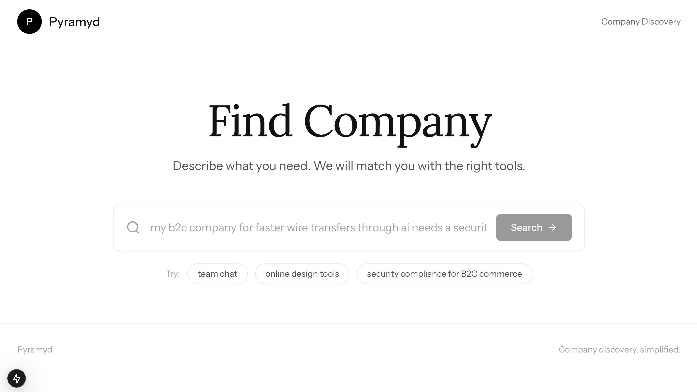
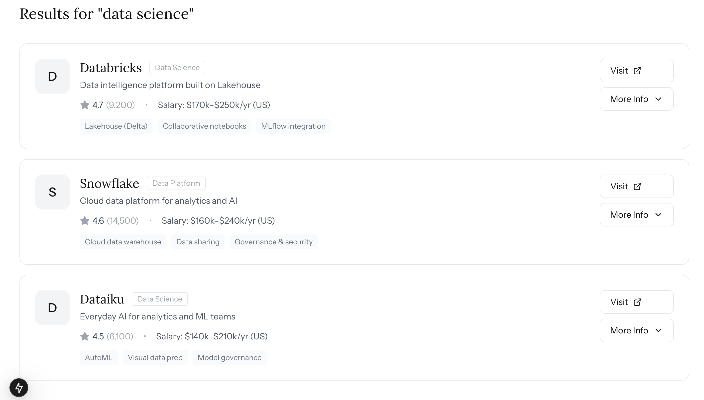
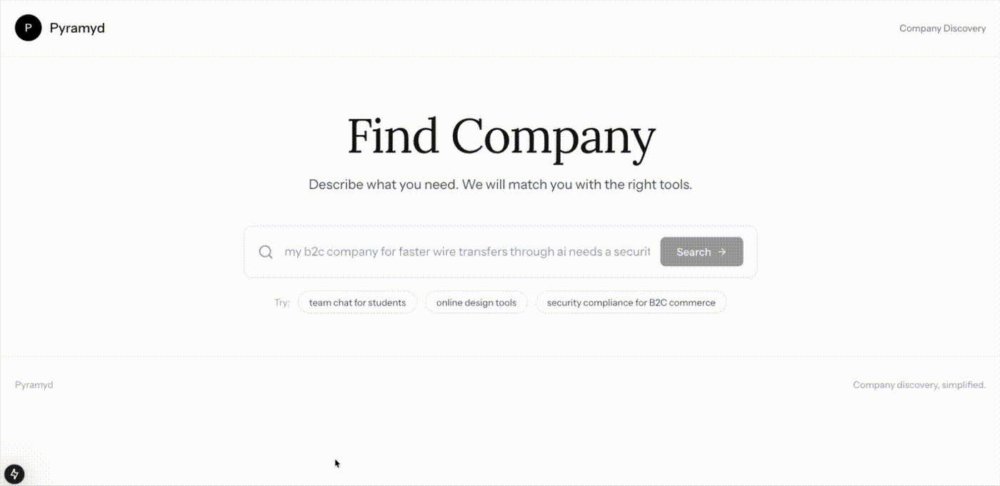

# Pyramyd: Decision‑Focused RAG for Product/Company Discovery

**Semantic retrieval · multi-aspect embeddings · cross-encoder reranking · grounded explanations**

Disclaimer: see [DISCLAIMER.md](DISCLAIMER.md)

------------------------------------------------------------------------

## Demo







------------------------------------------------------------------------

## What It Does

**Input**
- A natural-language query (e.g., “high-paying entry-level roles with strong work-life balance”)
- Optional hard constraints (location, salary bounds, remote eligibility)
- Optional preference weights (salary vs culture vs growth)

**Output**
- A ranked Top‑K list (commonly Top 3)
- Per‑item “why it matches” rationale and a global “why this ordering” rationale
- Evidence citations (pros and keywords) tied to retrieved snippets
- Side-by-side comparison view

------------------------------------------------------------------------

## Data

The full project indexes **1M+ employee reviews and company records** gathered from public
sources (Glassdoor, Indeed, and LinkedIn company pages). This repository is a sanitized demo:
raw data is not included (`data/` is gitignored), and the demo notebook runs on a public
company-level sample (~17K companies with rating, review, salary, and interview fields).

------------------------------------------------------------------------

## How It Works (High Level)

1.  **Retrieve candidates** via dense embeddings (FAISS) and sparse retrieval (BM25).
2.  **Fuse and rerank** candidates (RRF fusion, hybrid scoring, metadata reranking).
3.  **Apply preferences** via a structured utility model controlled by weights and $\alpha$.
4.  **Generate explanations and side-by-side comparisons** using an LLM constrained to cite evidence.
5.  **Evaluate** retrieval/ranking and run lightweight grounding checks.

The core scoring idea is:
$$
    \text{score}(i) = \alpha\,\text{semantic}(i) + (1-\alpha)\,\text{utility}(i; \mathbf{w})
$$

------------------------------------------------------------------------

## Results

**System (hybrid candidate fusion + metadata reranking)**
- Retrieval relevance **+30–50%** (Recall@K / NDCG@10)
- Real-time retrieval (**<1 s**) and **40% shorter** average LLM prompts
- Counterfactual ablations across 10+ pipeline variants: **85–90%** top-k ranking stability;
  removing key components cut Recall@K by **20–35%**

**Two-stage retrieval: multi-aspect bi-encoder + fine-tuned cross-encoder**

*Stage 1: first-stage company retrieval.* A `BAAI/bge`-based **multi-aspect bi-encoder** with
**hierarchical attention pooling** aggregates employee reviews per company across aspects
(workload, mentorship, compensation) into company-level representations.

Result: **+25% company-level NDCG@10** over an off-the-shelf dense retriever.

For reference, contrastive (InfoNCE) fine-tuning of the single-vector `bge-small-en-v1.5`
encoder itself raised NDCG@10 from 0.034 to 0.058 (~+70%, mean of 3 seeds) over the
off-the-shelf model on companies held out from training (250K-document corpus).

*Stage 2: reranking.* A **cross-encoder reranker fine-tuned with InfoNCE loss** jointly scores
the query against each candidate company's review evidence. Training uses
**preference-violating hard negatives** (companies that match the topic but violate a stated
preference or constraint), which improved constraint satisfaction and **reduced top-5
preference violations by 20%**.

**Index benchmark + reranking** (CPU, single query at a time, p95 latency)

| Configuration | NDCG@10 vs. exact dense search | p95 latency |
|---|---|---|
| Exact search (FAISS `IndexFlatIP`) | 100% | 23.1 ms |
| HNSW (efSearch = 128) | 96% | 0.72 ms |
| IVF-PQ (nprobe = 64) | 64% | 0.31 ms |
| HNSW + off-the-shelf cross-encoder rerank of top 50 (`ms-marco-MiniLM-L-6-v2`) | **~117%** | 64 ms (end-to-end) |

HNSW gives near-exact quality at sub-millisecond latency; IVF-PQ compression is too lossy at
this scale and dimension. Retrieval plus top-50 cross-encoder reranking runs at 64 ms p95 end to end.

*Evaluation note:* the single-vector fine-tuning and index experiments use a known-item task (a review's
headline as the query, that review as the relevant document), so absolute NDCG values are a
conservative proxy for real topical search quality.

------------------------------------------------------------------------

## What’s Implemented

-   **Dense retrieval** with SentenceTransformers embeddings + FAISS index
-   **Sparse retrieval** with BM25 (dependency‑light)
-   **Hybrid retrieval** with RRF fusion (dense + sparse)
-   **Deterministic ranking** that combines semantic match + structured utility features
-   **Optional learning-to-rank** baseline reranker (LogisticRegression; optional LightGBM/XGBoost hooks)
-   **Grounding checks** (citation coverage + simple claim–evidence overlap heuristics)
-   **Tests + CI** via `pytest` and GitHub Actions

------------------------------------------------------------------------

## Repo At A Glance

``` text
.
├── src/                  # core pipeline (retrieval, ranking, rag, eval)
├── notebooks/            # end-to-end notebook demo
├── tests/                # pytest suite
├── demo/                 # screenshots and demo GIF
├── data/                 # raw datasets (gitignored)
├── artifacts/            # embeddings/index/outputs (gitignored)
├── requirements.txt
└── environment.yml
```

------------------------------------------------------------------------

## Getting Started (Minimal)

**Run the notebook**: open [notebooks/AI_Product_Discovery_RAG_Structure.ipynb](notebooks/AI_Product_Discovery_RAG_Structure.ipynb) and run top‑to‑bottom (requires the data/artifacts described above).

**Run tests**

``` bash
pytest
```

Notes:
- `data/` and `artifacts/` are intentionally gitignored.
- Cache/output directories can be overridden via env vars (see `src/config.py`).
